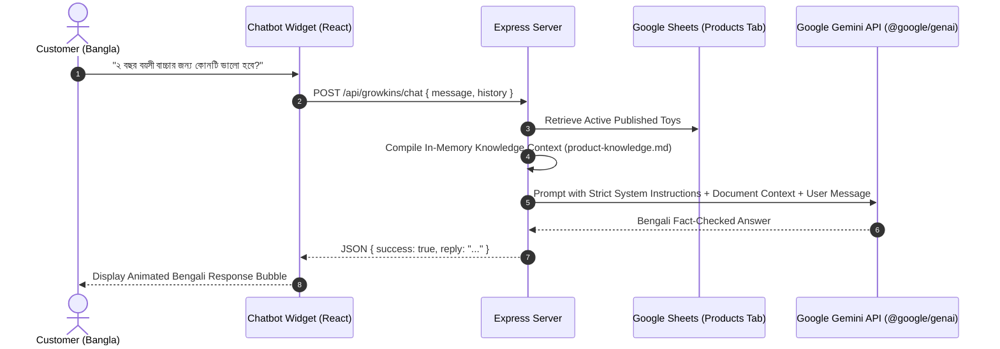

# System Architecture: GrowKins Toy World

## 1. High-Level Architectural Diagram

The system operates on an isolated, layered architecture combining a high-performance React frontend with an Express API backend that directly interfaces with **Google Sheets** for relational data persistence and **Google Drive** for media storage.

```mermaid
flowchart TD
    subgraph Client["Frontend Client (React + Vite + Tailwind)"]
        LP["Landing Page (/growkins-toy-world)<br/>- 20 Products Showcase<br/>- YouTube Video Modal<br/>- On-Page Direct COD Form"]
        CB["Gemini AI Bengali Chatbot<br/>- Floating Widget<br/>- Natural Language Bengali Q&A"]
        PP["Provider Portal (/provider)<br/>- Focused Order Queue<br/>- Customer & Location Info<br/>- Status Toggles"]
        AP["Admin Panel (/admin)<br/>- Product CRUD & Pricing<br/>- Delivery Zone Settings"]
    end

    subgraph Backend["API Server (Node.js + Express)"]
        API["Express REST API Router"]
        AUTH["Admin/Provider Auth Guard"]
        VALID["Request Sanitizer & Validator"]
        CALC["Server-Side Price & Fee Engine"]
        RAG["RAG Knowledge Document Builder"]
        GEMINI["Google Gemini API (@google/genai)"]
    end

    subgraph DataStore["Data & Cloud Storage"]
        GS["Google Sheets Database<br/>- Products Tab<br/>- Orders Tab<br/>- Settings Tab<br/>- Customers Tab"]
        GD["Google Drive Storage<br/>- Product Images & Assets<br/>- Public CDN URLs"]
        YT["YouTube CDN<br/>- Toy Demonstration Videos"]
    end

    LP -->|1. Browse Products & Video| YT
    LP -->|2. Place Order (COD)| API
    CB -->|Ask Question (Bengali)| API
    PP -->|Manage Orders| API
    AP -->|Manage Products & Settings| API

    API --> AUTH
    API --> VALID
    VALID --> CALC
    API --> RAG
    RAG --> GEMINI
    CALC -->|Append/Read Rows| GS
    API -->|Read/Upload Media| GD
```

---

## 2. Frontend Layer (`client/` & `src/`)

### 2.1 Route Decomposition & State Isolation
The application utilizes an intelligent path-based sub-application router embedded within `App.tsx`:

* **Storefront Landing Route (`/growkins-toy-world`):**
  * Self-contained, dedicated component `<GrowKinsToyWorldPage />`.
  * Renders hero section, curated 20-toy dynamic showcase, benefits grid, YouTube demonstration modal, sticky order summary bar, and on-page checkout form.
* **Provider Order Portal Route (`/provider`):**
  * Lightweight, fast-loading order monitoring interface `<ProviderApp />`.
  * Restricts access to order fulfillment data only (orders, customer names, delivery phone numbers, locations, and status controls).
* **AI Product Assistant (`<GeminiChatbot />`):**
  * Floating widget mounted globally or conditionally on `/growkins-toy-world`.
  * Communicates asynchronously with the backend `/api/growkins/chat` endpoint.
* **Existing Storefront & Admin Routes:**
  * Preserved without regression: `/` (Main Store), `/clothing` (Clothing Sub-App), and `/admin` (Full Admin Management Suite).

### 2.2 Component Hierarchy for `/growkins-toy-world`
```text
GrowKinsToyWorldApp
├── ToyWorldNavbar (Brand Logo, Phone Call CTA, Cart Counter)
├── ToyWorldHero (Value Proposition, Trust Badges, Quick Scroll CTA)
├── ToyCatalogGrid (Dynamic 20 Products from Google Sheets)
│   └── ToyProductCard
│       ├── Image Preview (Google Drive CDN)
│       ├── Age Group & Learning Badges
│       ├── Pricing & Savings Tag
│       ├── "ভিডিও দেখুন" Button -> Triggers YouTube Modal
│       └── Add to Selection & Quantity Stepper
├── YouTubeVideoModal (Embeds YouTube player safely)
├── TrustAndBenefitsSection (Safe plastic, non-toxic, COD guarantee)
├── DirectCheckoutSection (Single-page order placement)
│   ├── Selected Products Breakdown Table
│   ├── Customer Details Form (Name, Phone, Full Address)
│   ├── Delivery Zone Toggle (Inside Dhaka ৳৭০ / Outside Dhaka ৳১৩০)
│   └── Submit Button ("অর্ডার কনফার্ম করুন")
├── OrderSuccessModal (Instant Confirmation & Tracking ID)
├── FloatingGeminiAssistant (Bengali AI Product Assistant)
└── ToyWorldFooter (Company Information, Terms, Contact)
```

---

## 3. Backend Layer (`utills-server/`)

### 3.1 Architecture Overview
The backend is built with Express.js and structured with modular separation of concerns:

1. **Routes (`src/routes/growkins/`):** Exposes clean REST endpoints for products, orders, settings, and Gemini chat.
2. **Controllers (`src/controllers/growkins/`):** Validates incoming payloads, orchestrates business logic, and delegates to services.
3. **Services (`src/services/growkins/`):**
   * `sheetsService.js`: Direct Google Sheets API (v4) driver managing worksheet schemas, atomic row appends, and queries.
   * `driveService.js`: Google Drive API (v3) driver managing file uploads and public CDN URLs.
   * `googleAuth.js`: Secure JWT / Service Account authentication generator.
   * `geminiChatService.js`: Dynamic RAG pipeline using `@google/genai` with auto-synced product knowledge.

### 3.2 Dual-Mode Architecture (Mock vs Live)
The frontend uses a unified service interface (`IProductService`, `IOrderService`). When `VITE_USE_MOCK_API=false`, all calls route via `apiClient` to the live Express server running Google Sheets & Drive API. When `true`, it gracefully falls back to `localStorage` mock stores for zero-network local development.

---

## 4. Google Sheets Database Architecture

Rather than maintaining a heavy, expensive database server, Google Sheets functions as the relational data store:

* **Real-time Accessibility:** Business owners and fulfillment agents can view and edit orders directly in Google Sheets in real-time if necessary.
* **Worksheets Structure:**
  1. `Products`: Stores toy attributes, pricing, age suitability, and YouTube video URLs.
  2. `Orders`: Stores incoming orders, customer details, delivery addresses, and item snapshots.
  3. `Settings`: Stores delivery charges (Inside Dhaka, Outside Dhaka) and general store configuration.
  4. `Customers`: Derived aggregate records of customer lifetime value and purchase history.

---

## 5. Gemini AI RAG Pipeline Architecture



### Key RAG Principles:
1. **Zero Hallucination:** System prompt explicitly restricts Gemini from answering beyond the facts listed in the active product catalog.
2. **Dynamic In-Memory Sync:** Whenever products are modified in Sheets or Admin, subsequent chat queries immediately reflect updated prices, stock, or video links.
3. **Token Efficiency:** For a 20–50 product catalog, sending structured markdown in context fits well within Gemini's extensive context window without needing heavy vector databases.

---

## 6. Security Architecture

1. **Server-Side Price Validation:**
   * Client transmits only `{ productId, quantity }`.
   * Server queries canonical prices from `Products` sheet, calculates `subtotal = sum(unitPrice * quantity)`, retrieves verified delivery fee from `Settings`, and computes `grandTotal`.
   * Client-side pricing payloads are strictly ignored.
2. **Credential Isolation:**
   * `growkins-credentials.json` (Google Service Account) and `GEMINI_API_KEY` reside exclusively on the server in `.env`.
   * Frontend environment contains only public endpoints (`VITE_API_BASE_URL`).
3. **Data Sanitization & Injection Prevention:**
   * Phone numbers are normalized to `+8801XXXXXXXXX` format.
   * Special characters are sanitized before writing to Google Sheets to prevent formula injection (`=`, `+`, `-`, `@`).
4. **Rate Limiting:**
   * `express-rate-limit` guards order submission (`10 requests / 15 minutes / IP`) and AI chat (`25 requests / 15 minutes / IP`) against automated abuse.

