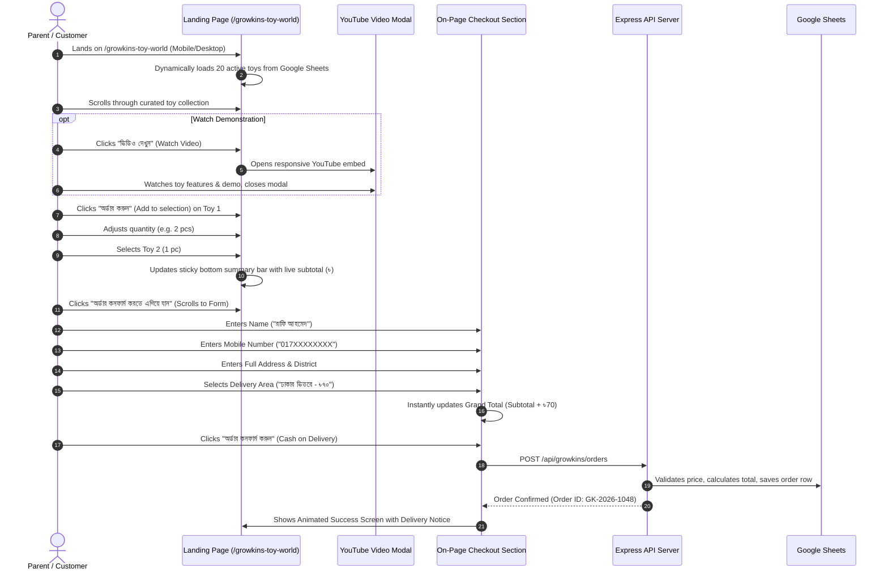
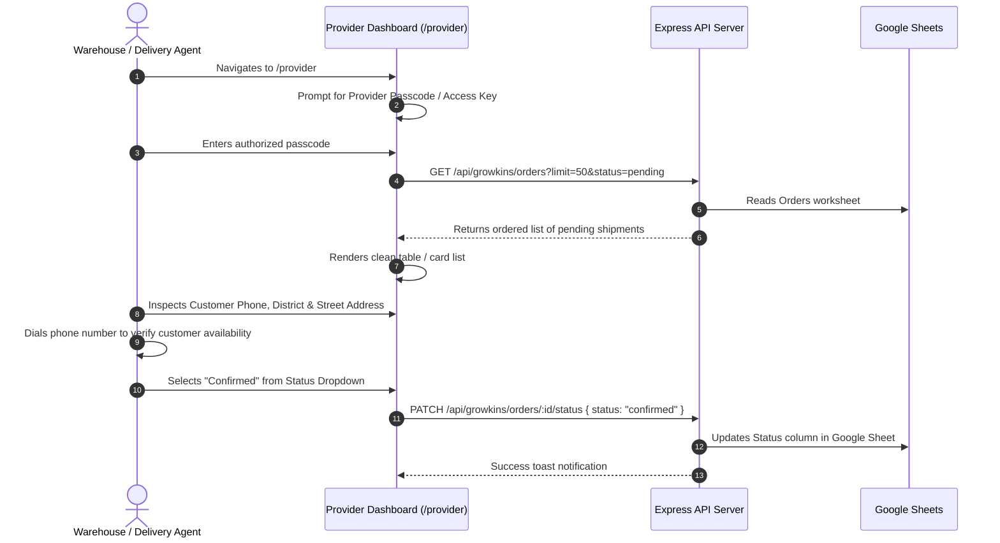
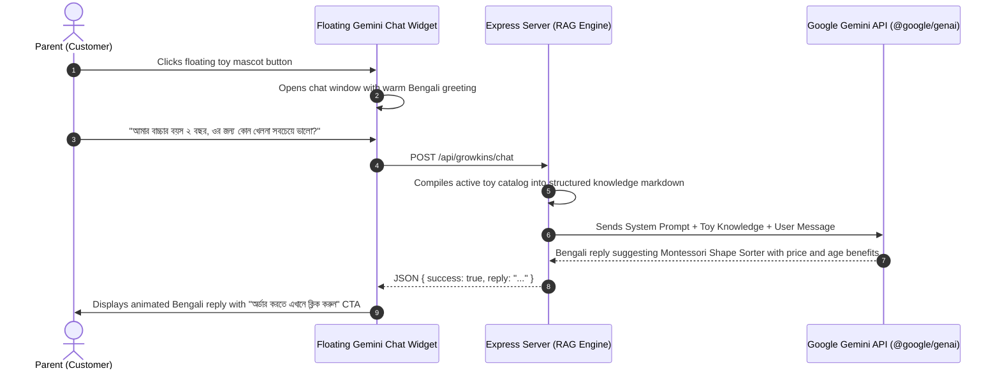

# User Flows: GrowKins Kids Toy E-commerce

## 1. Flow 1: Customer Storefront Journey (`/growkins-toy-world`)

This flow is designed for zero-friction ordering inspired by high-converting Bangladeshi e-commerce landing pages.

---

## 2. Flow 2: Provider / Order Fulfillment Journey (`/provider`)

This flow gives the warehouse/provider fulfillment team an unencumbered view of pending shipments without access to sensitive store settings.

---

## 3. Flow 3: AI Chatbot Inquiry Journey (Bengali Gemini RAG)

---

## 4. Flow 4: Admin Product & Settings Journey (`/admin`)

1. **Authentication:** Admin logs in using administrative credentials.
2. **Product Management:**
   * Admin navigates to `/admin/products`.
   * Clicks "নতুন খেলনা যোগ করুন" (Add New Toy).
   * Enters Name, Bengali subtitle, Price, Original Price, Age suitability, YouTube video link, and uploads image to Google Drive.
   * Clicks Save -> Row appended to `Products` worksheet -> AI knowledge document automatically invalidated.
3. **Delivery Charges Management:**
   * Admin opens `/admin/delivery`.
   * Updates inside Dhaka fee (e.g., from ৳৬০ to ৳৭০) or outside Dhaka fee.
   * Clicks Save -> Value saved in `Settings` worksheet -> Immediate reflection on storefront.

---

## 5. Error & Edge Case User Flows

| Edge Case | User Experience & System Handling |
| :--- | :--- |
| **Invalid Phone Number** | Frontend validates against regex `^01[3-9]\d{8}$`. If invalid, highlights field in red with Bengali error: *"সঠিক ১১ ডিজিটের মোবাইল নম্বর দিন"*. Backend re-validates and rejects with 400 if bypassed. |
| **Double-Click on Order Submit** | Submit button enters `disabled` state with animated spinner immediately upon first click. Prevents duplicate rows in Google Sheets. |
| **YouTube Video Unavailable** | If a product has no `videoUrl` or is invalid, the "ভিডিও দেখুন" button is automatically hidden, showing only the product photo gallery. |
| **Network Failure during Checkout** | Catch block displays a retry banner: *"দুঃখিত, সংযোগে সমস্যা হয়েছে। অনুগ্রহ করে আবার চেষ্টা করুন।"* without resetting entered customer information. |
| **Out-of-Stock Product Selected** | Backend checks `inventory.quantity`. If 0, responds with error: *"দুঃখিত, এই খেলনাটি বর্তমানে স্টকে নেই"*. |

